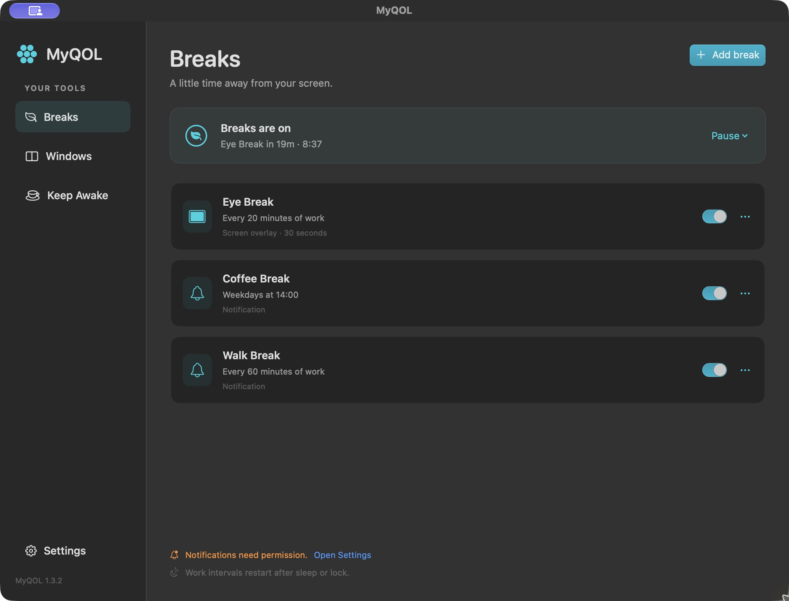
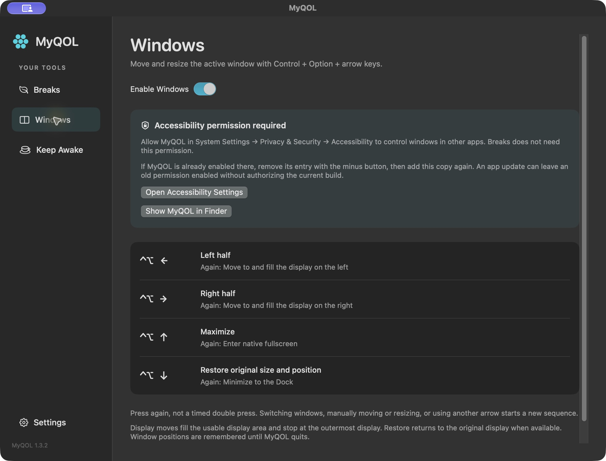
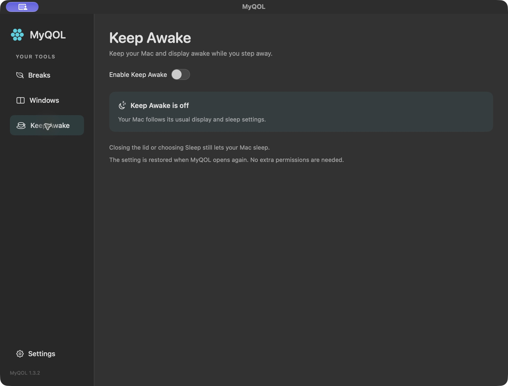

# MyQOL

Make your Mac a little more comfortable. MyQOL brings break reminders, window shortcuts, and a keep-awake switch to your menu bar.

[Download MyQOL for Mac](https://github.com/Jixxus/myqol-releases/releases/latest)

## Breaks

Give your eyes a rest, make time for coffee, or get up for a walk. Create reminders that fit your day, with regular work intervals or a weekly schedule. Choose a gentle notification or a screen overlay when it's time to step away.

## Windows

Put your workspace in place without reaching for the mouse. Use Control + Option + arrow keys to snap windows, fill the screen, and move between displays. Bring a window back to its original size and position with a shortcut.

## Keep Awake

Keep your Mac and display awake during a presentation, a long download, or a quick step away. One switch keeps them awake until you're ready to let them rest.

